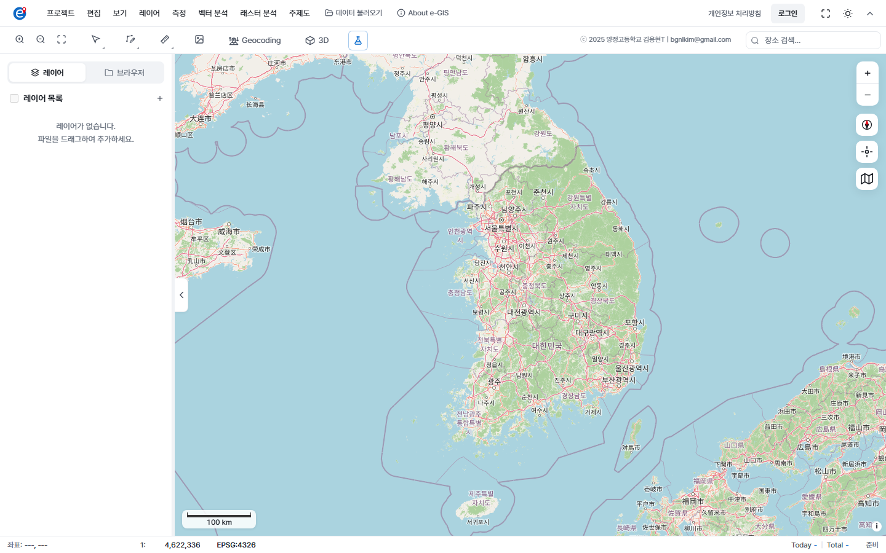

# e-GIS (교육용 웹 GIS)

GIS를 처음 접하는 교사와 학생을 위한 웹 GIS입니다. 설치 없이 브라우저에서 지도를 불러오고, 꾸미고, 분석하고, 저장합니다. 메뉴바, 툴바, 레이어 패널, 속성 테이블로 이루어진 화면이 QGIS와 닮아 있어서, e-GIS로 익힌 뒤 QGIS로 자연스럽게 넘어갈 수 있습니다.

- 서비스 주소: https://e-gis.kr
- 사용 설명서: https://e-gis.kr/guide (원문 [docs/사용설명서.md](docs/사용설명서.md))
- 데스크톱 앱 e-GIStory 내려받기: https://github.com/yhk1m/e-gis/releases/latest



## 특징

- **설치 없음**: 브라우저만 있으면 컴퓨터, 태블릿, 휴대폰에서 씁니다. 홈 화면(바탕화면)에 앱처럼 추가할 수도 있습니다.
- **QGIS와 닮은 화면**: 메뉴바, 툴바, 레이어 패널, 속성 테이블 구조를 그대로 따릅니다.
- **공공데이터 약 1,100종**: 서울열린데이터광장(349종), 경기데이터드림(749종), 인천데이터포털, 공공데이터포털 자료를 앱 안에서 검색해 바로 지도에 올립니다.
- **좌표계 자동 감지**: 불러온 자료의 좌표계를 스스로 판정해 지도에 맞게 바꿉니다. 한국에서 쓰는 좌표계 16종을 지원합니다.
- **클라우드 저장**: 로그인하면 프로젝트를 저장하고 어디서나 이어서 작업합니다.
- **휴대폰 전용 화면**: 휴대폰에서는 햄버거 서랍, 레이어 버튼, 아래에서 올라오는 패널로 바뀝니다. 태블릿에서는 툴바가 줄어듭니다.
- **라이트와 다크 테마**, 전체 화면 버튼.

## 할 수 있는 일

### 데이터 불러오기
- **실습 데이터**: 점, 선, 면(시도, 시군구, 서울 자치구, 세계 국가 경계), 래스터(한반도 전체와 광역자치단체별 DEM), 흐름(지역 간 이동량), 속성정보(결합용 표) 여섯 묶음을 바로 불러옵니다.
- **공공데이터**: 지역(시도)과 이름으로 찾고, 포인트 레이어, 격자 집계, 히트맵 중 하나로 바로 추가합니다.
- **파일**: GeoJSON, Shapefile(ZIP), GeoPackage, DEM(GeoTIFF, IMG), 좌표가 든 CSV와 XLSX를 끌어다 놓아 불러옵니다.
- **구글 스프레드시트**: 공개 시트 링크를 붙여 넣어 속성 표나 좌표 점으로 가져옵니다.

### 지도와 레이어
- **배경지도**: 한국 탭(VWorld 일반, 흰색, 야간, 위성)과 세계 탭(OSM, OpenTopoMap, Esri 위성, 어두운 지도)으로 나뉩니다.
- **레이어 관리**: 표시와 숨김, 끌어서 순서 바꾸기, 이름 바꾸기, 합치기, 속성값이나 객체 단위로 나누기, 내보내기를 합니다.
- **여러 레이어 한꺼번에**: 레이어 여러 개를 골라 스타일 바꾸기, 지우기 같은 작업을 한 번에 합니다.
- **스타일 편집**: 면과 선 색, 불투명도, 선 두께와 모양(실선, 파선, 점선, 일점쇄선)을 정합니다.
- **포인트 모양**: 점을 원, 선 아이콘 12종(집, 학교, 병원, 건물, 공장, 산, 나무, 기차역, 공항, 항구, 깃발, 별), 직접 올린 그림 중 하나로 그립니다.
- **지도 도구**: 장소 검색(지오코딩), 좌표계 바꾸기, 축척 직접 입력, 나침반 회전, 현재 위치, 북마크를 씁니다.

### 속성과 편집
- **속성 테이블**: 정렬, 여러 줄 선택, 셀 편집, 피처 삭제, 엑셀에서 한글이 깨지지 않는 CSV 저장을 합니다.
- **테이블 결합과 필드 계산기**: 다른 표의 값을 키 열로 붙이고, 식으로 새 열을 만듭니다.
- **속성 카드**: 고른 피처의 속성을 지도 위 카드로 바로 봅니다.
- **그리기와 편집**: 점, 선, 면(멀티 포함)을 그리고, 피처를 합치거나(다른 레이어끼리도) 선으로 자르고, 되돌립니다.
- **이미지 올리기와 지리참조**: 그림을 지도 위에 얹고, 기준점을 찍어 실제 좌표에 맞춥니다.

### 분석과 주제도
- **측정**: 거리와 면적.
- **벡터 분석**: 버퍼, 격자 만들기, 보로노이 다이어그램, 공간 연산(합집합, 교집합, 차집합, 클리핑, 폴리곤 안팎 점 뽑기), 등시선, 최단 경로.
- **래스터 분석**: 지형음영, 경사도, 경사 방향, 래스터 계산기, 등고선 만들기.
- **주제도**: 단계 구분도, 도형 표현도(차트 지도), 히트맵, 카토그램, 흐름도(이동량 화살표, 애니메이션, 클릭 거르기), 라벨.
- **3D 보기**: 지금 지도를 지형 위에 입혀 3D로 돌려 보고, 높이 과장을 바꾸고, PNG로 저장합니다.

### 실험실
아직 다듬는 중인 기능을 켜고 끄며 써 보고, 앱 안의 의견 창으로 의견을 보냅니다.
- **글래스**: 패널, 메뉴, 범례를 반투명 유리 모양으로 보여 줍니다.
- **범례 구간 꾸미기**: 범례의 색 칸을 눌러 구간마다 색, 패턴, 이미지, 질감을 바꿉니다.
- **지구본**: 지금 지도를 지구본으로 돌려 보고 투영법을 바꿉니다.
- **스와이프 비교**: 레이어나 배경지도 둘을 가운데 막대를 끌어 비교합니다.
- **시계열**: 연도별 열을 슬라이더로 넘기며 변화를 보고 GIF나 동영상으로 저장합니다.

### 저장과 내보내기
- 프로젝트 저장과 열기(`.egis` 파일), 자동 저장, 최근 파일, 클라우드 저장.
- 지도 이미지(PNG, JPG)와 PDF, 레이어 데이터(GeoJSON, SHP 등) 내보내기.

## e-GIStory (데스크톱 앱)

e-GIS로 만든 지도를 슬라이드로 엮어 스토리맵(발표 자료)을 만드는 Windows 프로그램입니다. e-GIS를 안에 품고 있어서 지도 작업과 발표 준비를 한 창에서 나란히(분할 모드) 할 수 있습니다. 두 프로그램은 `.egis` 프로젝트 파일로 이어집니다.

- 내려받기: [GitHub Releases](https://github.com/yhk1m/e-gis/releases/latest)에서 `e-GIS-Setup-<버전>.exe` (지금 최신은 v0.3.3)
- 할 수 있는 일: 페이지(슬라이드) 만들기, 지도 위치 정하기, 배경지도와 글꼴 꾸미기, 발표 모드, 발표 PDF, 웹에 게시해 공유 링크 만들기(`e-gis.kr/<아이디>/<번호>`), 클라우드 동기화
- 소스 코드: [eStoryMap/](eStoryMap/) (Electron)

## 실행하기

Node.js 18 이상이 필요합니다.

```bash
npm install
npm run dev        # 개발 서버 (http://localhost:3000)
npm run build      # 실습 래스터 목록 만들기 + 빌드 + 개인정보 처리방침, 설명서 페이지 미리 만들기
npm test           # vitest
```

배포는 Vercel입니다(`npx vercel deploy --prod`, 도메인 e-gis.kr). `api/` 폴더의 함수가 공공데이터 요청을 대신 보내 인증키를 브라우저에 드러내지 않습니다.

### 실습 데이터 추가

```bash
# 래스터: public/data/builtin/raster/ 에 GeoTIFF를 넣고
npm run catalog
# 점, 선, 면, 속성: public/data/builtin/practice/ 아래에 넣고 practice_catalog.json 에 직접 등록
```

자세한 방법은 [docs/practice-data-guide.md](docs/practice-data-guide.md)에 있습니다.

### 환경 변수

`.env.example`을 `.env`로 복사해 값을 채웁니다. 값은 저장소에 올리지 않습니다.

| 이름 | 쓰는 곳 |
|---|---|
| `VITE_SUPABASE_URL`, `VITE_SUPABASE_ANON_KEY` | 로그인과 클라우드 저장 |
| `VITE_VWORLD_KEY` | VWorld 배경지도 (비우면 한국 탭이 빠짐) |
| `SEOUL_OPENAPI_KEY`, `GG_OPENAPI_KEY`, `INCHEON_OPENAPI_KEY`, `DATA_GO_KR_KEY` | 공공데이터 중계 함수(`api/pubdata.js`, Vercel 환경 변수) |

## 기술

| 구분 | 사용한 것 |
|---|---|
| 빌드와 화면 | Vite 5, 바닐라 JavaScript(프레임워크 없음) |
| 지도 | OpenLayers 9, proj4 |
| 3D와 지구본 | three.js |
| 서버 | Supabase(로그인, PostgreSQL), Vercel 함수(공공데이터 중계) |
| 공간 분석 | Turf.js, geotiff.js, d3-contour, ngraph(경로), mathjs(필드 계산기, 지리참조) |
| 자료 읽기 | shpjs, sql.js(GeoPackage), SheetJS(XLSX), PapaParse(CSV, 구글 시트) |
| 그림과 내보내기 | Chart.js, D3, html2canvas, jsPDF, gifenc |

## 파일 구성

```
index.html                 앱 화면
guide.html                 사용 설명서 페이지 (빌드 때 docs/사용설명서.md 로 채움)
privacy.html               개인정보 처리방침 페이지
api/                       공공데이터 중계 함수와 카탈로그 (서버 전용)
src/
  main.js                  앱 조립
  core/                    지도, 레이어, 좌표계 감지, 저장, 로그인, 경로 탐색
  loaders/                 GeoJSON, Shapefile, GeoPackage, DEM, 흐름, 표, 구글 시트 읽기
  tools/                   분석, 주제도, 그리기, 편집, 내보내기 도구
  ui/                      패널, 대화상자, 휴대폰 셸, 툴바 묶음
  flow/                    흐름도
  globe/                   지구본
  view3d/                  3D 보기
  labs/                    실험실 기능 목록과 의견 보내기
  styles/                  CSS (dangto.css 는 지금 디자인을 덮어쓰는 층)
public/data/builtin/       실습 데이터
eStoryMap/                 e-GIStory 데스크톱 앱 (Electron)
scripts/                   빌드, 카탈로그 생성, 도로망 만들기, 검증 스크립트
docs/                      사용 설명서, 요구사항, 실습 데이터 안내, 설계 문서
supabase-*.sql             Supabase 테이블과 정책
```

## 문서

- [사용 설명서](docs/사용설명서.md)
- [요구사항 문서](docs/eGIS_Requirements.md)
- [실습 데이터 추가 안내](docs/practice-data-guide.md)
- [MCP 설정 안내](docs/MCP_Setup_Guide.md)

## 개발 참고

Windows에서 폴더 경로에 한글이 있으면 rollup이 빌드 도중 멈춥니다. 그래서 `npm run build`는 `scripts/build.cjs`를 거쳐, 이 경우 폴더를 빈 드라이브 문자에 잠시 연결해 영문 경로에서 빌드합니다. 영문 경로나 Linux, macOS(Vercel 포함)에서는 그냥 `vite build`를 실행합니다.

## 라이선스

MIT License. 자세한 내용은 [LICENSE](LICENSE)에 있습니다.

## 만든 사람

양정고등학교 지리교사 김용현  
문의: bgnlkim@gmail.com

유튜브 [비그늘](https://youtube.com/@rainshadow21), 커뮤니티 [네이버 카페](https://cafe.naver.com/egiskr)
